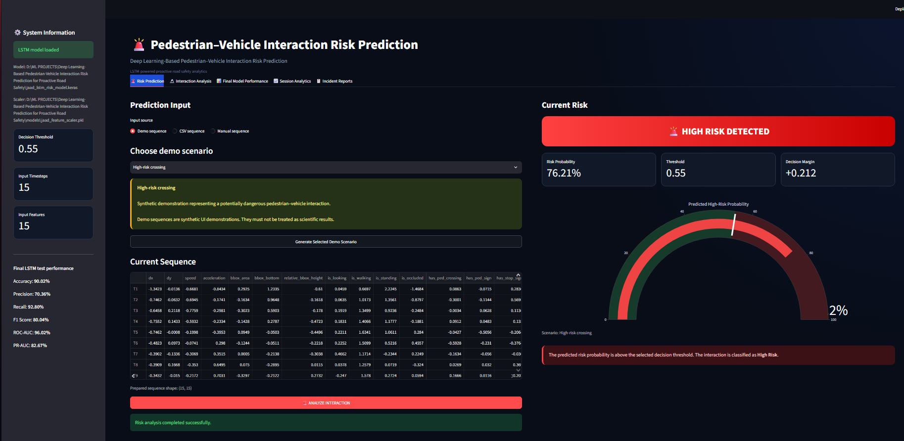
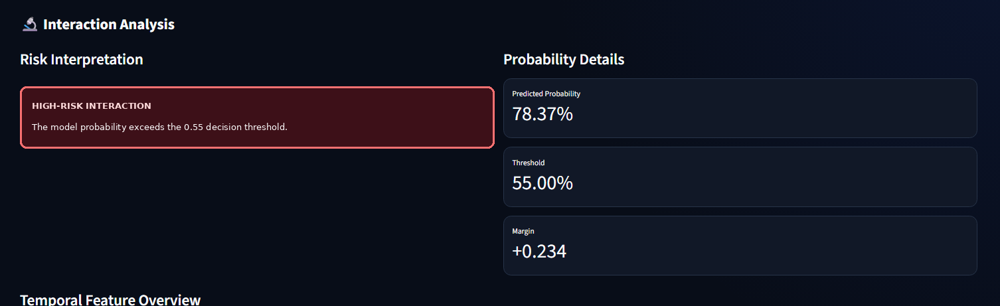
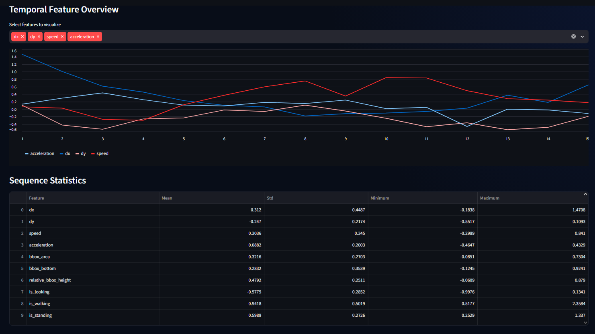
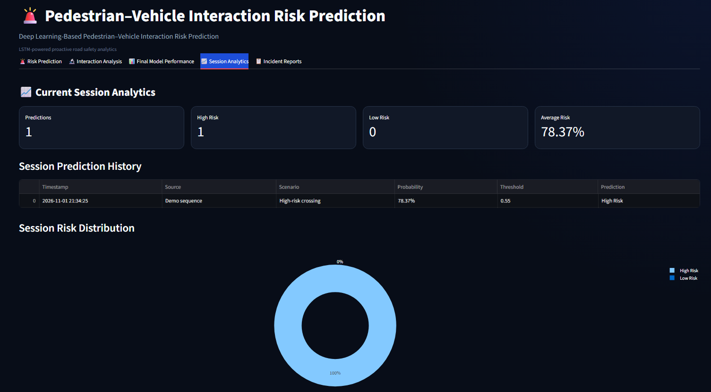
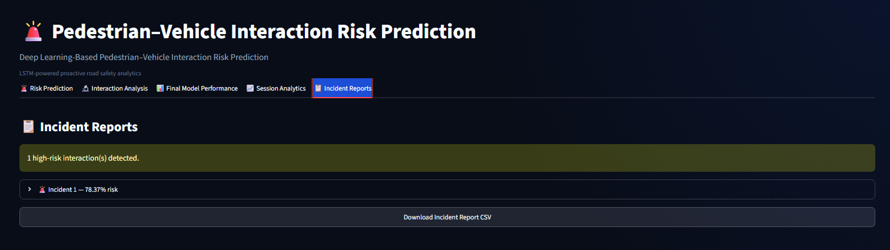

# DeepVision: Pedestrian--Vehicle Interaction Risk Prediction

An LSTM-based deep learning application for **proactive
pedestrian--vehicle interaction analysis** using temporal behaviour and
road-context features from the JAAD (Joint Attention in Autonomous
Driving) dataset.

The system analyses a short sequence of pedestrian observations and
estimates whether the pedestrian is likely to be annotated as crossing
at a future time horizon. A Streamlit dashboard presents the prediction,
probability, temporal feature behaviour, session analytics and
downloadable incident reports.

> **Important interpretation:** In this project, "High Risk" is a
> dataset-defined future-crossing proxy label. It indicates that the
> pedestrian's JAAD annotation is `crossing` 15 frames after the
> observed sequence. It is **not** a direct prediction of collision,
> injury, or accident probability.

------------------------------------------------------------------------

## Contents

-   [Project Overview](#project-overview)
-   [Key Features](#key-features)
-   [Dataset and Risk-Label
    Definition](#dataset-and-risk-label-definition)
-   [Input Features](#input-features)
-   [System Architecture](#system-architecture)
-   [LSTM Model](#lstm-model)
-   [Training and Evaluation](#training-and-evaluation)
-   [Final Test Performance](#final-test-performance)
-   [Application Screenshots](#application-screenshots)
-   [Run the Application](#run-the-application)
-   [Required Model Artifacts](#required-model-artifacts)
-   [Repository Structure](#repository-structure)
-   [Limitations and Future
    Improvements](#limitations-and-future-improvements)

------------------------------------------------------------------------

## Project Overview

Pedestrian movement is dynamic. A single video frame may not provide
enough information to understand whether a pedestrian is approaching a
crossing event. This project uses a sequence of observations so that the
model can learn temporal patterns in movement, bounding-box geometry,
pedestrian behaviour and road context.

### Project objectives

1.  Prepare pedestrian and traffic annotations from the JAAD dataset.
2.  Engineer numerical features describing pedestrian movement,
    behaviour and surrounding road context.
3.  Generate temporal input sequences and future-crossing labels.
4.  Train and evaluate an LSTM-based binary classifier.
5.  Compare the LSTM with Logistic Regression, Random Forest and XGBoost
    baselines.
6.  Build an interactive Streamlit application for prediction and
    analysis.

------------------------------------------------------------------------

## Key Features

-   **Three input modes:** synthetic demo sequence, CSV sequence and
    manual sequence entry.
-   **Temporal prediction:** accepts 15 time steps, each containing 15
    features.
-   **Risk probability:** displays the model's predicted probability and
    the configured decision threshold.
-   **Interaction analysis:** visualises selected temporal features and
    sequence statistics.
-   **Model evaluation:** presents classification metrics and
    model-performance visualisations.
-   **Session analytics:** records predictions made during the current
    application session.
-   **Incident reports:** filters high-risk predictions and supports CSV
    export.
-   **Interactive charts:** uses Plotly for gauges, line charts,
    distributions and performance visualisations.

Demo scenarios are synthetic UI demonstrations. They are useful for
demonstrating the interface but should not be treated as additional
scientific test results.

------------------------------------------------------------------------

## Dataset and Risk-Label Definition

### Dataset

The project uses the **JAAD (Joint Attention in Autonomous Driving)**
dataset, which contains driving-scene videos with pedestrian-level
behavioural annotations and traffic-context annotations.

Dataset reference: [JAAD
Dataset](https://data.nvision2.eecs.yorku.ca/JAAD_dataset/)

The preprocessing workflow combines pedestrian annotations with traffic
annotations, processes the available video tracks, cleans the records
and constructs model-ready features.

### What makes a sample High Risk or Low Risk?

The target is created from the pedestrian's future crossing annotation:

  -----------------------------------------------------------------------
  Label                   Project meaning         Dataset rule
  ----------------------- ----------------------- -----------------------
  `1` --- High Risk       Future crossing         `crossing` annotation
                          indicated               15 frames ahead

  `0` --- Low Risk        Future crossing not     `not-crossing`
                          indicated               annotation 15 frames
                                                  ahead
  -----------------------------------------------------------------------

For each pedestrian track:

1.  Observations are ordered by video, pedestrian track and frame.
2.  The crossing annotation is shifted **15 frames into the future**.
3.  If the future annotation is `crossing`, the target is `1`.
4.  If the future annotation is `not-crossing`, the target is `0`.
5.  Records without a valid future frame are excluded from the
    model-ready dataset.

This makes the task a **future pedestrian-crossing prediction problem**.
The labels do not establish that a collision will occur. "Risk" is the
application's name for the future-crossing classification and should be
interpreted within that scope.

### Temporal setup

-   Observed input length: **15 consecutive frames**
-   Prediction horizon: **15 frames ahead**
-   Model input shape: **(15, 15)** --- 15 time steps × 15 features
-   Output: one sigmoid probability for the positive class (`High Risk`)

The exact time represented by 15 frames depends on the frame rate of the
source video.

------------------------------------------------------------------------

## Input Features

The model uses 15 numerical features for every time step.

  -----------------------------------------------------------------------
  Feature                             Description
  ----------------------------------- -----------------------------------
  `dx`                                Change in pedestrian position along
                                      the horizontal axis

  `dy`                                Change in pedestrian position along
                                      the vertical axis

  `speed`                             Estimated pedestrian movement speed

  `acceleration`                      Change in movement speed

  `bbox_area`                         Area of the pedestrian bounding box

  `bbox_bottom`                       Vertical position of the bottom
                                      edge of the bounding box

  `relative_bbox_height`              Bounding-box height relative to the
                                      image/frame scale

  `is_looking`                        Whether the pedestrian is annotated
                                      as looking

  `is_walking`                        Whether the pedestrian is annotated
                                      as walking

  `is_standing`                       Whether the pedestrian is annotated
                                      as standing

  `is_occluded`                       Whether the pedestrian is partially
                                      or fully occluded

  `has_ped_crossing`                  Presence of a pedestrian-crossing
                                      road annotation

  `has_ped_sign`                      Presence of a pedestrian sign
                                      annotation

  `has_stop_sign`                     Presence of a stop-sign annotation

  `has_traffic_light`                 Presence of a traffic-light
                                      annotation
  -----------------------------------------------------------------------

Categorical annotations are converted into numerical indicators. A
`StandardScaler` is fitted using the training data and then applied to
validation, test and application inputs.

------------------------------------------------------------------------

## System Architecture

``` text
JAAD Videos + Pedestrian / Traffic Annotations
                    |
                    v
          Annotation Extraction
                    |
                    v
       Cleaning and Feature Engineering
                    |
                    v
     Future-Crossing Target Generation
       (crossing state 15 frames ahead)
                    |
                    v
          Video-Level Data Split
             70% / 15% / 15%
                    |
                    v
        Feature Scaling and Sequencing
          (15 time steps × 15 features)
                    |
                    v
          Regularized LSTM Network
                    |
                    v
       Sigmoid Probability (0 to 1)
                    |
                    v
       Decision Threshold = 0.55
                    |
          +---------+---------+
          |                   |
          v                   v
       High Risk           Low Risk
          |                   |
          +---------+---------+
                    |
                    v
        Streamlit Dashboard and Reports
```

The train, validation and test partitions are created at the **video
level** to reduce the chance of frames from the same video appearing in
multiple partitions.

------------------------------------------------------------------------

## LSTM Model

The final model is a regularized, stacked LSTM network. LSTM layers are
used because the input consists of ordered observations and the model
needs to learn temporal dependencies across frames.

  -------------------------------------------------------------------------
  Layer                   Configuration             Purpose
  ----------------------- ------------------------- -----------------------
  Input                   `(15, 15)`                Receives 15 frames with
                                                    15 features each

  LSTM 1                  32 units,                 Learns temporal
                          `return_sequences=True`   patterns and passes the
                                                    sequence onward

  Dropout                 0.35                      Reduces overfitting

  LSTM 2                  16 units                  Learns a compact
                                                    sequence representation

  Dropout                 0.35                      Further regularisation

  Dense                   16 units, ReLU            Learns non-linear
                                                    combinations of
                                                    temporal features

  Dropout                 0.30                      Regularisation

  Output                  1 unit, Sigmoid           Produces the
                                                    probability of the High
                                                    Risk class
  -------------------------------------------------------------------------

### Training configuration

-   Optimiser: Adam
-   Learning rate: `0.0005`
-   Loss: Binary cross-entropy
-   Gradient clipping: `clipnorm = 1.0`
-   L2 regularisation: `0.001`
-   Maximum epochs: 30
-   Batch size: 256
-   Class weighting: balanced class weights
-   Early stopping: monitors validation AUC and restores the best
    weights
-   Learning-rate reduction: reduces the learning rate when validation
    loss stops improving

------------------------------------------------------------------------

## Training and Evaluation

The project evaluates the LSTM against three classical machine-learning
baselines:

-   Logistic Regression
-   Random Forest
-   XGBoost

The evaluation includes:

-   Accuracy
-   Precision
-   Recall
-   F1-score
-   ROC-AUC
-   PR-AUC
-   Confusion matrix and error analysis

The operating threshold converts the model's probability into a class
prediction:

``` python
predicted_class = 1 if risk_probability >= 0.55 else 0
```

A threshold of **0.55** is used in this project presentation and
dashboard configuration. The threshold is a decision setting, not a
probability calibration guarantee. Changing it changes the
precision/recall trade-off.

------------------------------------------------------------------------

## Final Test Performance

The following values are the LSTM test metrics at the **0.55 decision
threshold**.

  Metric            Result
  ----------- ------------
  Accuracy      **90.24%**
  Precision     **73.70%**
  Recall        **85.12%**
  F1-score      **79.00%**
  ROC-AUC       **96.02%**
  PR-AUC        **82.67%**

**Interpretation:** The model correctly classifies 90.24% of the
evaluated test samples. Its 85.12% recall means it identifies 85.12% of
the samples labelled as future-crossing in the test set at the 0.55
threshold. ROC-AUC and PR-AUC describe ranking performance across
thresholds and are not tied to a single class threshold.

------------------------------------------------------------------------

## Application Screenshots

### 1. Risk Prediction Dashboard

Select a demo scenario, upload a CSV sequence or enter a sequence
manually. After analysis, the dashboard displays the predicted class,
probability, threshold and decision margin.



### 2. Interaction Analysis

The interaction-analysis view presents the predicted probability
alongside the decision threshold and visualises temporal features from
the input sequence.



### 3. Temporal Feature Overview

The line chart allows the user to inspect how selected features change
across the 15 input time steps. Sequence statistics summarise the mean,
standard deviation, minimum and maximum values.



### 4. Session Analytics

The session analytics page summarises predictions made during the
current session, including high-risk and low-risk counts, average
probability, prediction history and risk distribution.



### 5. Incident Reports

The incident-report page lists predictions classified as High Risk and
provides an option to download the report as a CSV file.



------------------------------------------------------------------------

## Run the Application

### 1. Clone the repository

``` bash
git clone https://github.com/Yuvankrish3012/deepvision-pedestrian-risk-prediction.git
cd deepvision-pedestrian-risk-prediction
```

### 2. Create and activate a virtual environment

**Windows**

``` bash
python -m venv .venv
.venv\Scripts\activate
```

**Linux / macOS**

``` bash
python3 -m venv .venv
source .venv/bin/activate
```

### 3. Install dependencies

``` bash
pip install --upgrade pip
pip install numpy pandas streamlit plotly scikit-learn tensorflow joblib
```

### 4. Place the model artifacts

The application requires the trained model and scaler. Keep the
filenames and locations consistent with the paths configured in
`app.py`.

A suggested layout is:

``` text
project-root/
├── app.py
├── jaad_lstm_risk_model.keras
├── models/
│   ├── jaad_feature_scaler.pkl
│   ├── feature_config.json
│   └── risk_threshold.json
└── assets/
```

Example `risk_threshold.json`:

``` json
{
  "risk_threshold": 0.55
}
```

Example `feature_config.json`:

``` json
{
  "features": [
    "dx",
    "dy",
    "speed",
    "acceleration",
    "bbox_area",
    "bbox_bottom",
    "relative_bbox_height",
    "is_looking",
    "is_walking",
    "is_standing",
    "is_occluded",
    "has_ped_crossing",
    "has_ped_sign",
    "has_stop_sign",
    "has_traffic_light"
  ],
  "sequence_length": 15,
  "risk_horizon": 15
}
```

### 5. Configure the project path

If `app.py` contains a machine-specific absolute Windows path, replace
it with a repository-relative path:

``` python
PROJECT_DIR = Path(__file__).resolve().parent
MODELS_DIR = PROJECT_DIR / "models"
```

This allows the project to run after cloning it into a different
directory.

### 6. Launch Streamlit

``` bash
streamlit run app.py
```

Streamlit will print a local URL in the terminal. Open that URL in your
browser.

------------------------------------------------------------------------

## Required Model Artifacts

The application cannot make predictions using only the README or source
code. It needs the trained model and the matching preprocessing scaler.

  -----------------------------------------------------------------------
  Artifact                            Purpose
  ----------------------------------- -----------------------------------
  `jaad_lstm_risk_model.keras`        Trained LSTM model

  `jaad_feature_scaler.pkl`           Fitted feature scaler used during
                                      training

  `feature_config.json`               Feature order and sequence
                                      configuration

  `risk_threshold.json`               Decision threshold configuration
  -----------------------------------------------------------------------

**Important:** The scaler and model must come from the same training
pipeline. The feature order must also match the order used during
training.

The JAAD dataset and trained model binaries may be large or subject to
dataset access terms. Do not commit them to GitHub without checking the
applicable distribution terms and repository size limits. If needed,
provide download instructions or use an appropriate large-file hosting
method.

------------------------------------------------------------------------

## Repository Structure

A recommended repository layout is:

``` text
deepvision-pedestrian-risk-prediction/
│
├── app.py
├── DeepVision_Risk.ipynb
├── requirements.txt
├── README.md
│
├── models/
│   ├── jaad_feature_scaler.pkl
│   ├── feature_config.json
│   └── risk_threshold.json
│
├── assets/
│   ├── dashboard-risk-prediction.png
│   ├── interaction-analysis.png
│   ├── temporal-feature-overview.png
│   ├── session-analytics.png
│   └── incident-reports.png
│
└── .gitignore
```

The trained `.keras` model can be stored in the repository or downloaded
separately, depending on its size and distribution permissions.

------------------------------------------------------------------------

## Limitations and Future Improvements

### Current limitations

-   The target represents future pedestrian crossing behaviour, not
    confirmed collision risk.
-   The prediction horizon is expressed in frames; its real-time
    duration depends on the source video frame rate.
-   Demo sequences are synthetic and intended only to demonstrate the
    interface.
-   The application is a research/academic prototype and should not be
    used as a standalone real-world traffic-safety system.
-   Prediction quality depends on annotation quality, feature extraction
    and similarity between the training data and the input scenario.

### Future improvements

-   Integrate live video input and automated pedestrian tracking.
-   Add vehicle trajectory, distance and time-to-collision features.
-   Extend the target definition to include validated near-miss or
    collision-risk annotations.
-   Evaluate generalisation on additional driving datasets and unseen
    environments.
-   Add model explainability and per-feature contribution analysis.
-   Improve calibration and validate the decision threshold for
    different deployment conditions.

------------------------------------------------------------------------

## Acknowledgements

-   **JAAD Dataset:** Joint Attention in Autonomous Driving dataset.
-   **TensorFlow / Keras:** LSTM model development.
-   **Scikit-learn:** Preprocessing, baseline models and evaluation.
-   **Streamlit:** Interactive application interface.
-   **Plotly:** Interactive data visualisations.

------------------------------------------------------------------------

## Author

**V Yuvan Krishnan**

GitHub: [@Yuvankrish3012](https://github.com/Yuvankrish3012)

Project repository:
[deepvision-pedestrian-risk-prediction](https://github.com/Yuvankrish3012/deepvision-pedestrian-risk-prediction)
